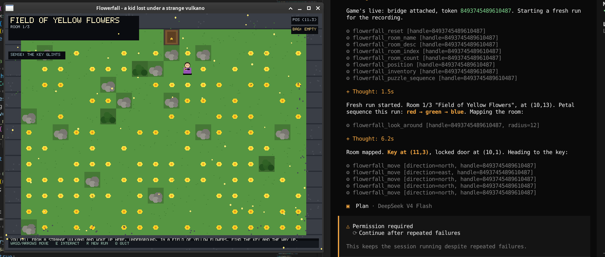

Seeker of power!  
Do you want to use C++ reflections to let clankers auto generate their MCP[^1] bindings
without you worrying about wasting your time with a mostly useless feature that is only
now barely working as claude engineers had too much to ship to build a decent protocol
first time?  

**Do you want MORE FREE TIME while telling your boss the codebase is now ✨AI READY💫[^2]?**  
Ehm ehm, look no further! I hereby present 「mcpp」

[^1]: They are a protocol to let agents communicate with applications. Yes, because in 2025 we forgot about HTTP and decided to reinvent it.
[^2]: Well, it must be a very recent codebase as only GCC supports reflection in mainline and behind a flag. But this kind of stuff ought to be more useful as time goes on.

# Introducing, mcp + p

A C++26 (gcc 16 `-freflection`) library that turns existing C++ functions into
a Model Context Protocol (MCP) server. Reflection derives tool names, JSON
schemas, and invocation from annotated structs, so there is no hand-written
registry or marshalling. Any MCP-standard client (like opencode, Claude Desktop etc.)
can then drive those functions as tools, resources, prompts, and completions.

You are not expected to write all annotations by hand. The bundled
`mcp-cpp-refactor` skill is the primary way for this library to be adopted:
an agent will register ordinary functions into a functional MCP instrumentation.  

But if you want to see how it works (and likely break) behind the veil:

```cpp
#include <mcpp/mcpp.hpp>
#include <mcpp-server/mcpp-server.hpp>

namespace app::groups {

struct [[= mcp::tool_group{} ]] ops {
    [[= mcp::tool{ .description = mcp::str("Adds two integers.") } ]]
    static auto add(std::int64_t a, std::int64_t b) {
        return (struct{ std::int64_t sum; }){ a + b };
    }
};

} // namespace app::groups

mcp::Registry registry() {
    return mcp::Registry{
        .actions = mcp::register_tagged_tools<^^app::groups, ^^mcp::tool_group, mcp::simdjson_parser>(),
        .resources = {}, .prompts = {}, .resource_templates = {},
    };
}

int main() {
    mcp::StdioStream stream;
    mcp::Server server(stream, registry());
    server.run();
}
```

> [!NOTE] 
> The boring parts of this repository, like examples and utility scripts, 
> were generated with the help of my clankers. If that bothers you, 
> well, looking for a library to integrate an MCP server into your project
> *might* not be 100% coherent behaviour. Still, everyone is welcome :).

## Demo



A fake game, generated from scratch just for the sake of testing, and
instrumented with MCP support with no further human intervention. On the right
opencode is playing it[^3].

[^3]: And it got stuck on the "continue after repeated
failures" permission prompt. Those are not real failures, just opencode permissions freaking out a bit.

## Components & dependencies

- **`mcp`**: the core, header-only and parser-free. It covers `JsonView` + `Protocol`
  dispatch, the reflection layer, serializers, and the stream abstraction. No
  external dependencies. Pass any JSON `Parser` (simdjson, or your own) at
  registration.
- **`mcpp-server`**: the compiled layer. A simdjson backend, a threaded `Server`
  (async tools run on a bounded worker pool), and `SocketHost` for
  multi-session unix-socket serving. Depends on simdjson and fmt.
- **`mcpp-bridge`**: a standalone *stdio* to *unix-socket* byte relay with slot
  authentication, for clients that cannot talk over a unix socket directly
  (like opencode, you fool). 

Consumers need `-freflection` (reflection splices live in the headers) and,
for `mcpp-server`, `-DSIMDJSON_EXCEPTIONS=0`. The library is exception-free
by default; the `exceptions` build config makes it exception-enabled.

To use the bridge manually you can do something like this:

```bash
# explicit socket path, authenticated slot:
mcpp-bridge /tmp/app-admin.sock admin
# or derive the path + slot from the environment:
MCP_SLOT=admin mcpp-bridge            # -> /tmp/mcp-demo-admin.sock
```

## Limitations & Compatibility

At this time we are only targetting POSIX platforms (Linux, macOS, the BSDs).  
The stream abstraction uses unix sockets and `read()`.  
Porting to Windows is possible I just don't care and so you should not :).

Also, we don't expose an HTTP server, we only operate in console and socket mode.  
Forwarding to an HTTP server would be trivial, I just don't have a special use 
for that right now.

## Build

```bash
xmake                            # library + mcpp-bridge only
xmake f --with_demo=y && xmake   # the optional examples too
xmake f --exceptions=y && xmake  # build the library exception-enabled
```

`mcp-example-binary` additionally pulls in the `capnproto` package for 
a not compliant experiment.

Self-checks: `xmake test` (or `./tools/check/check-demos.sh`).

## Install & the skill

```bash
xmake install -o <prefix>   # headers, libmcpp-server.a, mcpp-bridge, and the skill assets
```

`xmake install` ships the library to the prefix and, alongside it, the
`mcp-cpp-refactor` skill (`share/opencode/skills/`), the example sources as
reference material (`share/mcpp/examples/`), the vendored protocol specs
(`share/mcpp/specs/`), and a small helper script (`bin/mcpp-skill`).
Examples are never installed as binaries.

The `mcp-cpp-refactor` skill teaches an agent how to add MCP support to a C++26
project with this library. No that it would be that much more effort regardless.  
But still, free work is free work.  
`xmake install` puts it in the *shared* prefix; to make it available where
opencode actually loads it, copy it on request:

```bash
mcpp-skill                       # -> ${XDG_CONFIG_HOME:-~/.config}/opencode/skills
mcpp-skill --repo                # -> <cwd>/.opencode/skills  (project scope)
mcpp-skill --uninstall           # remove the installed copy
```

The copy bundles the reference examples as `<skill>/examples/`, so the skill
is self-contained even outside the library's repo. `mcpp-skill --help` for the
full usage. A restart of your client might be in order.

## Tools based on class member functions

A non-static member function carries an implicit `this`; over MCP that becomes an
injected `handle` argument the client sends with each call. The server resolves
it to the **caller-selected registered instance** and runs the member function
on that live object; state is shared across tools on the same instance, and
independent across instances (doh!).

```cpp
struct [[= mcp::tool_group{} ]] counter {
    [[= mcp::tool{ .description = mcp::str("Returns the counter's stored value.") } ]]
    auto get() { return (struct{ std::int64_t value; }){ state_ }; }
    std::int64_t state_ = 0;
};

// register the live object; the client sends `{"handle": <token>, ...}`.
mcp::object_handle<counter> handle(my_counter);
```

- `mcp::object_handle<T>` registers an object and returns an opaque random token
  (`object_token`); it revokes the token on destruction (RAII). `mcp::object_registry<T>`
  backs it with `issue`/`resolve`/`revoke`, guarded for concurrent sessions.
- The injected `handle` shows up in the tool's JSON schema as a required integer
  argument; static tools have no `handle`.
- A call with an unknown or **revoked** handle fails with a JSON-RPC error
  (`-32602`), on both the inline and async (`Server::on_async_call`) paths.
- Tools can also take a trailing `mcp::ActionContext&` for async/progress/cancellation.

## Protocol versions

Implements **MCP 2026-07-28** (sessionless: per-request `_meta`,
`server/discover`, `resultType`). Most current clients still use the older
`initialize` handshake, so by default the server also serves **2025-11-25**
(dual-era). Build modern-only with `xmake f --legacy2025=n`.

The object-handle model above is the protocol's recommended way to carry
cross-call state. Details on the 2026-07-28 wire, dual-era, and binary
transports: [docs/protocol.md](docs/protocol.md).

## Dependencies

The core (`mcp`) is header-only and parser-free, with no external
dependencies. The ones that exist:

### Core

- **[simdjson](https://github.com/simdjson/simdjson)** (Apache-2.0): the
  default JSON parser backend for `mcpp-server`.
- **[fmt](https://github.com/fmtlib/fmt)** (MIT): formatting used by the
  server layer.

### Marginal

- **[capnproto](https://github.com/capnproto/capnproto)** (MIT): only pulled
  in by the optional binary-transport example.

## License

Copyright (C) karurochari.

This library is free software: you can redistribute it and/or modify it under
the terms of the **GNU Lesser General Public License, version 3**
(`SPDX: LGPL-3.0`), see `LICENSE`.

What that means in practice:

- **The library stays open.** Any modified or derived version of the library
  itself must remain under this license, and its source must be made available
  on request when the library (or a combined work) is distributed.
- **Your application is yours.** A program that merely uses the library, open
  or closed source does not matter, is not tainted by the copyleft clause.  
  You may build and ship a proprietary product on top of `mcpp`.
- **One practical note for distributors:** LGPL requires that recipients of a
  binary can relink it against a modified version of the library. `mcpp-server`
  is a static library, so if you distribute a binary that embeds it you know
  what to do.


